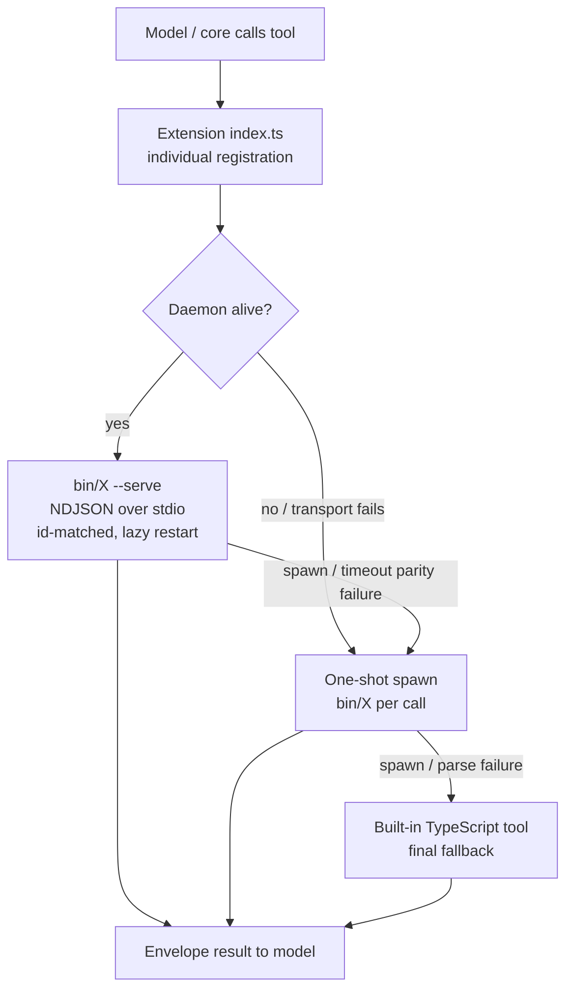
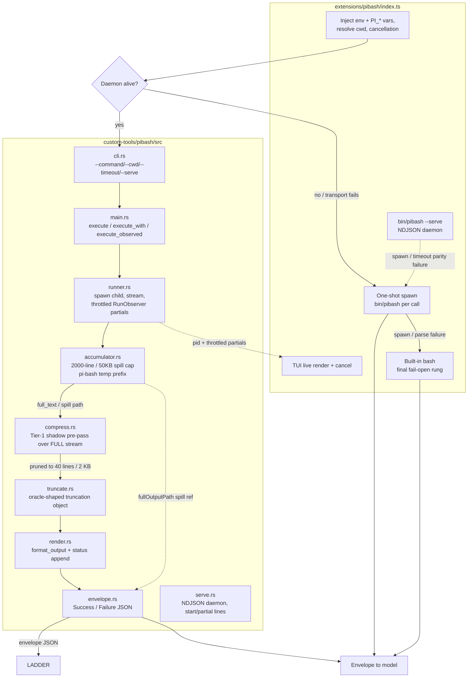
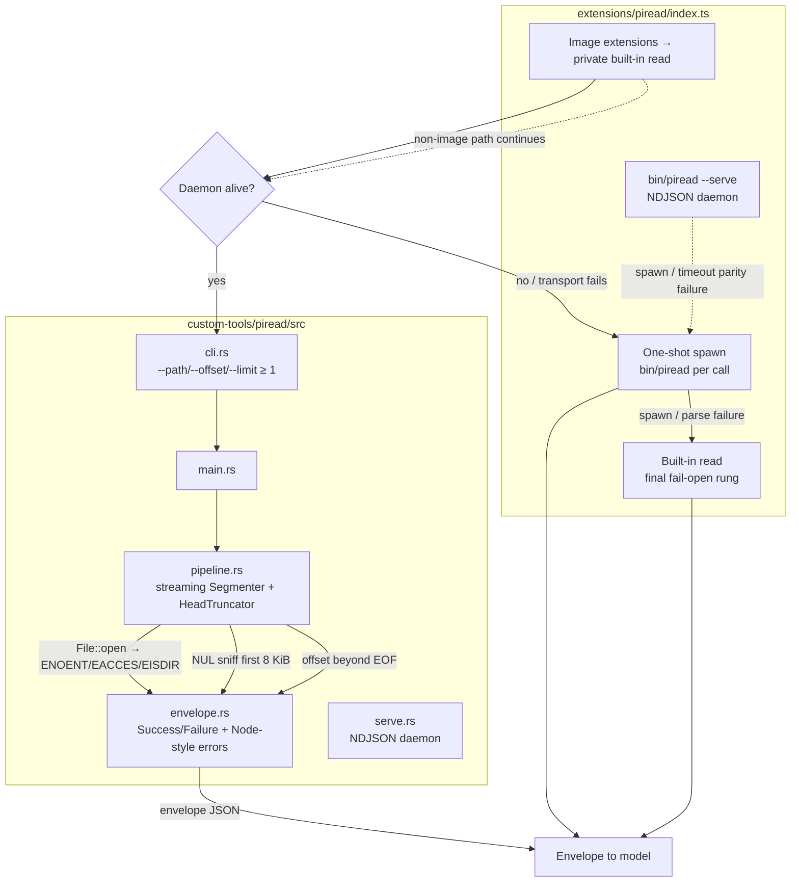
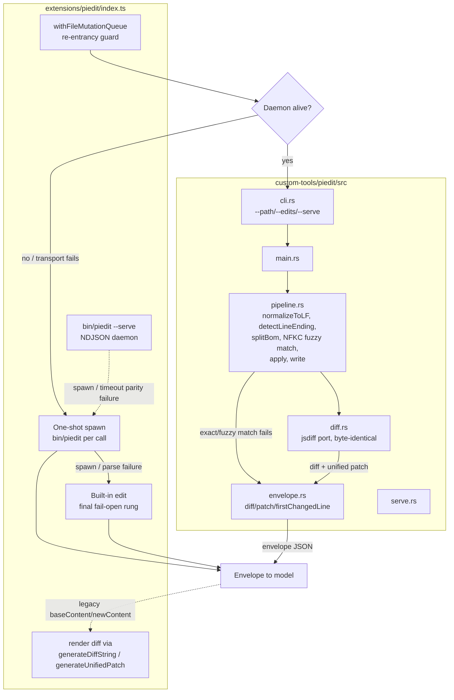
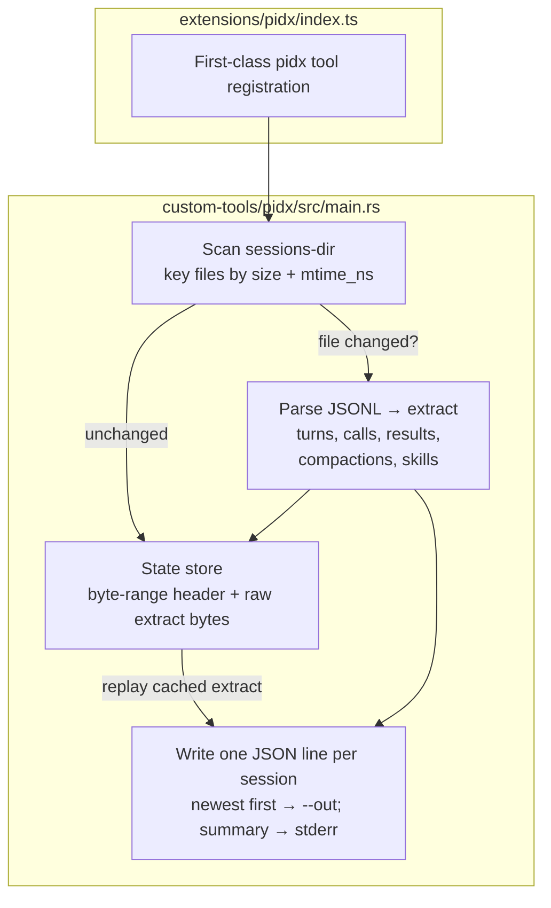

# Custom Tools Architecture

Four native Rust tools replace the pi built-in TypeScript tools. Each is a
standalone binary in `custom-tools/` with a matching extension in
`extensions/`. Every tool follows the same shape:

- **Extension** (`extensions/<name>/index.ts`) — individual registration, a
  **fail-open ladder** (`daemon → one-shot spawn → built-in`), and the
  session-sensitive glue (env + `PI_*` injection, cancellation, TUI render).
- **Daemon** (`--serve`) — a persistent NDJSON-over-stdio process so the hot
  path avoids per-call spawn cost. One request per line, id-matched, lazy
  restart on death, `unref`'d while idle / `ref`'d in flight.
- **One-shot** — a single `bin/<name>` spawn per call, the fallback when the
  daemon transport fails.
- **Built-in fallback** — the original TypeScript tool, the final rung.

Parity is pinned against the built-in by a harness suite (`tests/*-parity.test.mjs`)
and the permission-gate treats each native tool as a wrapper on the equivalent
event (`read`/`edit`/`bash`).

---

## Generic dispatch ladder

---

## pibash — native shell-output pipeline

Owns spawn + streaming + capping + truncation + spill + envelope. The built-in
bash tool (`dist/core/tools/bash.js`) stays the *oracle*; the extension owns env
injection and TUI rendering.

Key decision: a **shadow pre-pass** compresses the *complete* output stream
(from the spill file when one exists) before the legacy tail/parity path, so
errors buried mid-stream survive. The model-visible budget is 40 lines / 2 KB
(the permission-gate H1 cap), tighter than the accumulator's 2000-line / 50 KB
spill cap.

---

## piread — native read pipeline

One invocation runs open → slice → render → truncate → binary-detect, printing
a single JSON envelope. Byte-for-byte parity with the built-in `read`.

Memory contract: buffers at most `MAX_BYTES` (50 KB) of decoded output plus the
first line (for `firstLineExceedsLimit`); the rest of the file is scanned
(newline count, binary sniff) without buffering — a 1 GiB read costs O(cap).

---

## piedit — native edit pipeline

read → LF/BOM normalize → exact/fuzzy match → uniqueness/overlap validation →
apply → write → native diff/patch render.

The native dispatch runs under `withFileMutationQueue`; if it returns a
`{fallback}` sentinel the queue is released first, then the built-in executor
runs — avoiding the deadlock of re-entering the same queue.

---

## pidx — incremental session-log indexer

Parses `<sessions-dir>/<project>/<ISO-ts>_<uuid>.jsonl` transcripts into compact
per-session extracts consumed by session-audit's fast path.

Incremental contract: files keyed by `(size, mtime_ns)`; unchanged files replay
the cached extract without re-parsing or re-serializing. Warm runs are
O(changes), not O(archive). Exit 0 even with individually unparseable files
(they yield an extract with zero turns). The `PARITY:` notes inline pin
behaviour against the Node parser (`tsMs`, `ACTIVE_SESSION_MS`,
`IMAGE_BYTES_ESTIMATE`).
