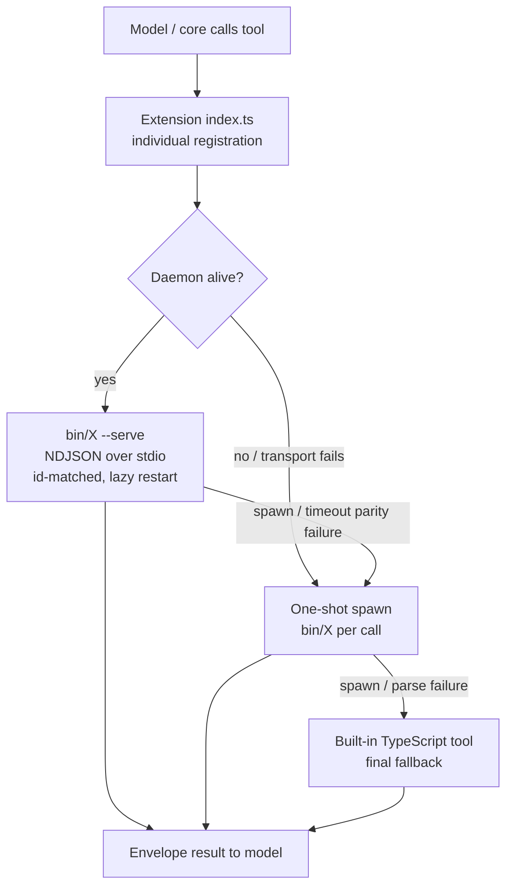
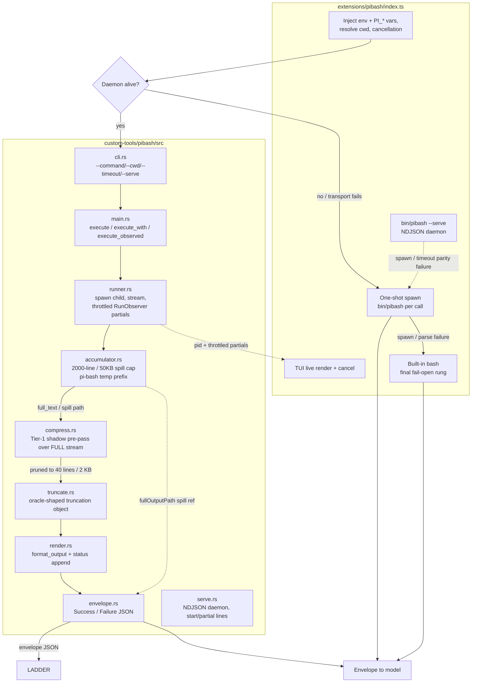
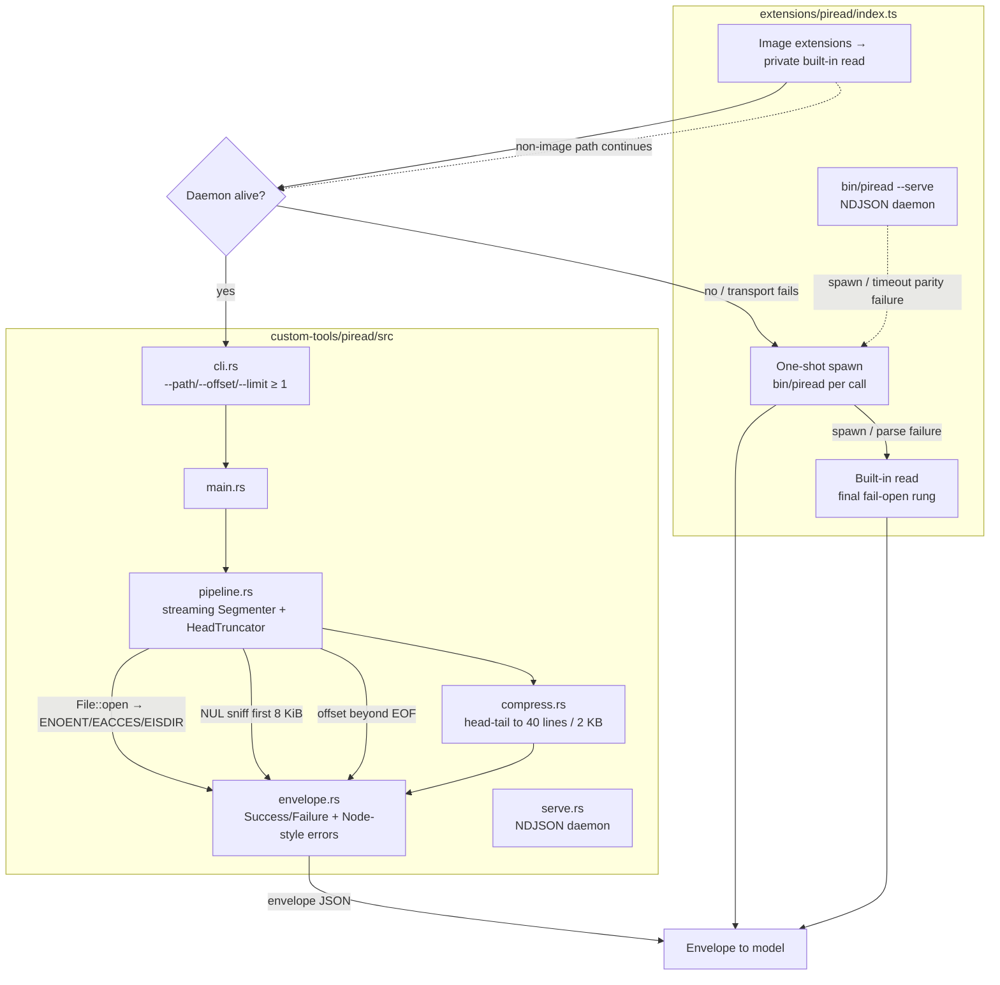
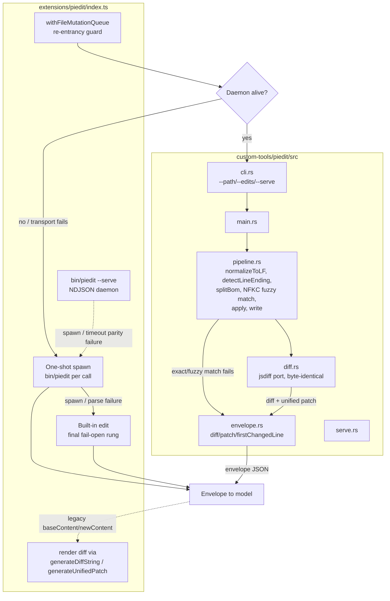
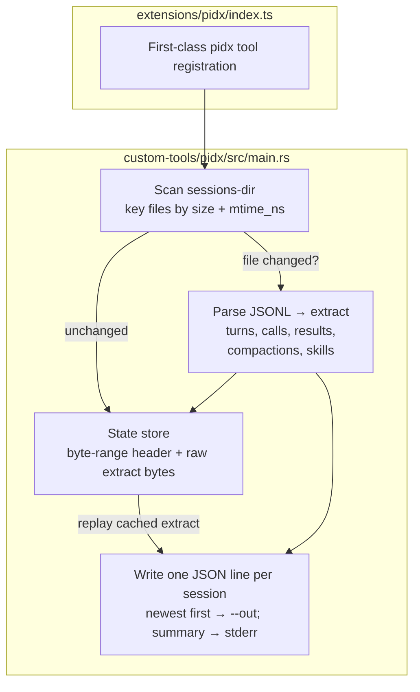

# Custom Tools Architecture

Four native Rust tools replace the pi built-in TypeScript tools. Each is a
standalone binary in `custom-tools/` with a matching extension in
`extensions/`. Every tool follows the same shape:

- **Extension** (`extensions/<name>/index.ts`) — individual registration, a
  **fail-open ladder** (`daemon → one-shot spawn → built-in`), and the
  session-sensitive glue (env + `PI_*` injection, cancellation, TUI render).
- **Daemon** (`--serve`) — a persistent NDJSON-over-stdio process so the hot
  path avoids per-call spawn cost. One request per line, id-matched, lazy
  restart on death, `unref`'d while idle / `ref`'d in flight.
- **One-shot** — a single `bin/<name>` spawn per call, the fallback when the
  daemon transport fails.
- **Built-in fallback** — the original TypeScript tool, the final rung.

Parity is pinned against the built-in by a harness suite (`tests/*-parity.test.mjs`)
and the permission-gate treats each native tool as a wrapper on the equivalent
event (`read`/`edit`/`bash`).

**Companion docs:** [`portability.md`](portability.md) (OS constraints),
[`backlog.md`](backlog.md) (open work). Per-crate build logs live in
`custom-tools/*/README.md`.

---

## Contents

- [Crate layout and dependencies](#crate-layout-and-dependencies)
- [Generic dispatch ladder](#generic-dispatch-ladder)
- [Daemon protocol and lifecycle](#daemon-protocol-and-lifecycle)
- [Process-group isolation](#process-group-isolation)
- [Context shaping (compression)](#context-shaping-compression)
- [Envelope serialization](#envelope-serialization)
- [pibash — native shell-output pipeline](#pibash--native-shell-output-pipeline)
- [piread — native read pipeline](#piread--native-read-pipeline)
- [piedit — native edit pipeline](#piedit--native-edit-pipeline)
- [pidx — incremental session-log indexer](#pidx--incremental-session-log-indexer)
- [Shared techniques](#shared-techniques)
- [Glossary](#glossary)

---

## Crate layout and dependencies

A Cargo workspace (`custom-tools/Cargo.toml`, resolver 2) holds four binary
crates sharing one `Cargo.lock` and one `target/`:

| Crate | Binary | Dependency surface |
| --- | --- | --- |
| `piread` | `bin/piread` | `serde`, `serde_json` (`preserve_order`) |
| `piedit` | `bin/piedit` | + `unicode-normalization` (NFKC); `tempfile` (dev) |
| `pibash` | `bin/pibash` | `serde`, `serde_json` (`preserve_order`); `tempfile` (dev) |
| `pidx` | `bin/pidx` | + `sha1`; `preserve_order`, `float_roundtrip` |

Deliberately kept small: no `tokio`, no `clap`, no `regex`, no `libc`. Threads
are `std::thread`; argument parsing is hand-written; `setsid`/`setpgid` are
declared as raw `extern "C"` rather than pulling in the `libc` crate.

Workspace release profile:

```toml
[profile.release]
opt-level = 3
lto = "fat"          # cross-crate inlining; the crates are small enough to afford it
codegen-units = 1    # better optimization at the cost of compile parallelism
panic = "abort"      # no unwinding machinery; these are short-lived processes
strip = true         # binary size only
```

`serde_json`'s `preserve_order` feature (backed by an index map) is enabled
everywhere because envelopes are compared **byte-for-byte** against the
TypeScript oracle — field order must be stable and match the JS object literal
order, not alphabetical.

---

## Generic dispatch ladder



The ladder is **fail-open**: every rung's failure advances to the next, and the
terminal rung is always the original TypeScript implementation. A missing
binary, a crashed daemon, or unparseable stdout degrades performance, never
correctness. Each terminal fallback writes exactly one stderr line
(`<tool>: fallback (<reason>) path=<path>`) and appends to
`logs/violation-memory.ndjson` — one line per event, not per rung.

Rung selection is recorded on `details.via` (`daemon` | `oneshot` | `builtin`),
which never enters model-visible content.

---

## Daemon protocol and lifecycle

All three daemons speak the same protocol: **newline-delimited JSON over stdio**.

Request (one line):

```jsonc
{ "id": 7, "path": "/abs/file", "offset": 5, "limit": 20, "cwd": "/abs/dir" }
```

Response (one line per request):

```jsonc
{ "id": 7, "ok": true, "content": "…", "truncation": null, "binary": false, "totalBytes": 12 }
{ "id": 7, "ok": false, "error": { "kind": "ENOENT", "message": "…" } }
```

`id` is echoed verbatim (any JSON value), so the client matches responses
without ordering assumptions. Requests are processed **serially in arrival
order** — the daemons are single-threaded over stdin, which removes a whole
class of ordering bugs at no measurable cost (indexing and file reads are not
the bottleneck; process spawn was).

### Rust side

`serve()` loops `stdin.lock().lines()`, which is streaming (not
block-buffered): a response is emitted as soon as a request line arrives, so
the client never waits for EOF. Malformed JSON still produces an error envelope
with the id echoed when it is recoverable; an unreadable stdin or an unwritable
stdout ends the loop (parent gone). Exit code is always 0 — per-request
failures are envelope errors, not process failures.

### Client side (the part that is easy to get wrong)

Node's child-process handles are refcounted against the event loop. The daemon
must not pin the host while idle, but a request in flight must keep the loop
alive or the await never settles. The rule enforced in the extensions:

| State | `proc` | `stdin` | `stdout` |
| --- | --- | --- | --- |
| idle | unref | unref | unref |
| request in flight | **ref** | ref | ref |

`refWhilePending()` refs all three; `maybeUnrefStreams()` must unref **all
three** when `pending` empties. Two real bugs came from getting this wrong:

- Ref'ing only `stdin`/`stdout` (not `proc`) let the loop drain mid-await → the
  host exits with an *unsettled top-level await* (exit 13).
- Unref'ing only `stdin`/`stdout` (not `proc`) after a settle left the process
  handle referenced → the host never exits at all.

Both are covered by `tests/daemon-exit.test.mjs` and
`tests/piread-daemon-settle.test.mjs`.

Other lifecycle rules:

- **Lazy start**: the daemon is spawned on first use, not at extension load.
- **Lazy restart**: a dead slot is cleared (`daemon = null`) and the next call
  starts a fresh one. `killDaemon` is idempotent (`state.dying`).
- **Dying slots are refused**: a request entering a slot whose `dying` flag is
  set, or whose stdin is destroyed/ended, rejects immediately rather than
  writing into a pipe that will never answer.
- **Write-failure settles**: a write error is the *only* remaining failure
  signal once a pipe is destroyed, so the callback rejects unconditionally
  rather than gating on the pending entry still being present.
- **Process exit hook**: one `process.on("exit")` kills the live daemon.

---

## Process-group isolation

Every `--serve` daemon calls `setpgid(0, 0)` at startup
(`custom-tools/*/src/procgroup.rs`), putting it in a process group of its own.

Without this the daemon inherits the client's process group, and any group-wide
signal reaches it — `pibash`'s own `kill_tree` signals `-<pid>` on a command
timeout, and job-control or CI timeouts do the same. A daemon killed that way
drops in-flight requests and forces a reconnect.

**Why `setpgid` and not `setsid`:**

- `setsid()` fails with `EPERM` when the caller is already a process-group
  leader — which is exactly how Electron/Node spawn children. Working around it
  needs a fork-first dance, which a daemon that must report its own pid cannot
  do simply.
- `setsid()` also starts a new *session* and drops the controlling terminal;
  a stdio daemon does not use the terminal, so that is more disruption than the
  isolation requires.
- `setpgid(0, 0)` on self is always legal, and is the same call Rust's
  `CommandExt::process_group(0)` makes for child processes (the pattern
  `runner.rs` already uses for pibash's shell children).

`setpgid` is POSIX.1 — present in glibc, musl, and Apple libSystem — and is
declared as a raw `extern "C"` symbol, so no `libc` dependency is added. On
non-unix the call compiles to a no-op. Verified by
`tests/daemon-process-group.test.mjs`.

---

## Context shaping (compression)

The permission-gate **H1 cap** limits what reaches the model to **40 lines /
2 KB**. Two tools shape their output to that same budget so the gate passes the
result through instead of re-cutting it. Compaction is what stops context cost
from scaling with file or command output size.

| Tool | Strategy | Notes |
| --- | --- | --- |
| `pibash` | head-tail / error-priority | command-aware; failures keep a 2/3 tail, successes a 2/3 head |
| `piread` | head-tail | 2/3 head : 1/3 tail; continuation notice kept last |
| `piedit` | none | returns a status line + diff — bounded by design |
| `pidx` | pointer only | extracts go to a file; only a pointer line enters context |

Shared rules:

- **Deterministic.** No clock, no run id, no hash iteration order. Same input →
  byte-identical output, so results are cacheable and diffable.
- **Idempotent.** A body already carrying the omission marker is never
  re-compacted (re-compaction would drop kept content and rewrite the count).
- **Explicit omission.** Every cut emits `[... omitted N chars / M lines ...]`
  with real counts — the same marker string in both tools, so one grep
  recognizes a compacted result from either.
- **UTF-8 safe.** Every cut lands on a character boundary.
- **Lossless elsewhere.** Full output is spilled to a temp file (`pibash`), or
  re-readable with a wider window (`piread`); `truncation` metadata is never
  rewritten, so the gate still sees true line counts.
- **Reversible.** `PI_READ_COMPRESS=0|false|off` disables `piread` compaction,
  restoring byte parity with the built-in `read`.

Measured effect (model-visible bytes, `npm run bench:model-visible`): a
~1900-line read drops from 51,188 B to 2,040 B; a 10k-line shell output from
10,129 B to 173 B. Totals across the suite: 273,312 B → 15,569 B (−94.3%).

`pibash`'s pipeline applies four stages in order — `strip_ansi`, `dedup_repeats`,
then a strategy (`error_priority` for Test/Build commands, `head_tail`
otherwise), each skipped when the text already fits the budget.

---

## Envelope serialization

Envelopes are compared byte-for-byte against the TypeScript oracle, so the
writers are hand-rolled rather than derived:

- **Fast string escaping.** A SWAR (SIMD-within-a-register) word scan tests 8
  bytes at a time for chars needing escape (`< 0x20`, `"`, `\`); clean spans
  are copied wholesale. After four consecutive dirty words it switches to
  byte-wise scanning, because escape-dense text makes the word tests cost more
  than they save. ~2.5× faster than `serde_json`'s writer with no regression on
  escape-heavy input, and pinned by a test that compares output against
  `serde_json` exhaustively over all single bytes and combinations.
- **Duplicate suppression.** `Truncation.content` is skipped when empty
  (`skip_serializing_if`): the full text already rides in `content[0].text`,
  so the extension reconstructs it. Halves the envelope for large truncated
  output without changing the rebuilt result.
- **Buffer reuse.** The daemon keeps one response `Vec<u8>` whose capacity
  ratchets to the largest response seen; each response is serialized in place,
  a newline appended, and emitted with a single `write_all` + `flush`.

---

## pibash — native shell-output pipeline

Owns spawn + streaming + capping + truncation + spill + envelope. The built-in
bash tool (`dist/core/tools/bash.js`) stays the *oracle*; the extension owns env
injection and TUI rendering.



### Execution

`runner.rs` spawns the shell via `std::process::Command` and reads both pipes
concurrently on separate threads (`drain_readers`), because a single-threaded
read deadlocks as soon as a child fills the pipe it is not being read from.

- **Shell resolution** (`resolve_shell`): `PI_BASH_SHELL` override → `/bin/bash`
  → `bash` on `PATH` → `sh`. It deliberately ignores `$SHELL`: a zsh login shell
  must not change which shell tool commands run under, matching the built-in.
- **Process group of the child**: `process_group(0)` (unix) so a timeout can
  signal the whole tree.
- **Timeout kill** (`signal_group`): `kill -<SIG> -<pid>` to hit the group, with
  a fallback to the bare pid. This is precisely the call that could previously
  reach the daemon itself — hence [process-group isolation](#process-group-isolation).
- **Reader grace period** (`READER_GRACE`, 30 ms): after the child exits,
  readers get a short window to drain buffered output so the tail is not lost.
- **`RunObserver`**: the daemon implements it to stream `started` (child pid, for
  cancellation) and throttled `partial` updates (`UPDATE_THROTTLE`, 100 ms,
  matching the built-in).

### Accumulation and spill

`OutputAccumulator` keeps the last 2000 lines / 50 KB in memory and spills the
full stream to a temp file (`pi-bash-<seed>.log`, private permissions) once it
grows past the cap:

- **`Utf8Stream`**: incremental UTF-8 decoding. Chunk boundaries fall inside
  multi-byte sequences, so it holds back incomplete trailing bytes and decodes
  only complete sequences — output is never mangled at a boundary.
- **`trim_tail`**: keeps the buffer bounded by dropping from the front, on a
  line boundary.
- **`read_full_output` / `full_text`**: give the compression pre-pass the
  *complete* stream (from the spill file when one exists), not just the visible
  tail — this is why errors buried mid-stream survive.
- **`snapshot`**: produces the oracle-shaped result plus an optional
  `fullOutputPath` reference.

### Compression

A **shadow pre-pass** runs over the complete output before the legacy
tail/parity path, so the model-visible budget (40 lines / 2 KB) is enforced on
the whole stream. Stages: `strip_ansi` → `dedup_repeats` → strategy.

`classify()` maps the command string to `Test | Build | Git | Search | Log |
Generic` by scanning shell-separated segments left to right and taking the first
recognized leading token (`rg foo && cargo test` → `Test`). `sudo` and
`VAR=value` prefixes are skipped.

`error_priority` (Test/Build) keeps actionable lines — errors, warnings,
failures, panics, assertions, stack frames, file/line refs, final summary —
and fills remaining budget with surrounding context. `head_tail` splits 2/3 : 1/3,
head-heavy on success and tail-heavy on failure, because a failure's summary
sits at the end. A single line larger than the whole budget is cut head+tail on
a UTF-8 boundary.

Constraint: a **generic** command's buried actionables are not scanned — it is
recorded as expected-non-retaining, matching the built-in oracle's behaviour.

---

## piread — native read pipeline

One invocation runs open → slice → render → truncate → binary-detect, printing
a single JSON envelope.



### Streaming parser

`Segmenter` wraps `BufReader::with_capacity(64 KiB)` and reads with
`read_until(b'\n')` into a reused buffer — one allocation per file, not per
line. It tracks `last_ended_newline` (initialised `true`) so an empty file
yields the single `[""]` segment the JS `split("\n")` semantics require, and
reports the trailing phantom segment exactly as the oracle does.

**Memory contract:** buffers at most `MAX_BYTES` (50 KB) of decoded output plus
the first line (needed for `firstLineExceedsLimit`). The rest of the file is
scanned — newline count and binary sniff — without buffering, so a 1 GiB read
costs O(cap). A NUL byte in the first 8 KiB marks the file binary and defers to
the built-in pipeline.

Byte accounting mirrors JS `Buffer.byteLength` on *decoded* text, and line
counting mirrors `splitLinesForCounting`, including the quirk that content
ending in a newline counts N lines rather than N+1.

### Compaction

`read_text` is a **pure, byte-exact** pipeline (the built-in's contract);
`read_text_compacted` — used by the CLI and `--serve` — applies the head-tail
pass. That split keeps the parity suite deterministic and avoids races on a
process-global env var (Rust tests run in parallel).

Two details that matter:

- The `[Showing lines A-B of C …]` continuation notice is **split off before
  slicing** and re-attached exactly once, last. It is the only place the reader
  learns the file continues; slicing it as body content made it appear twice.
- A single over-budget line is served by the head alone — a head+tail slice of
  one line is useless to a reader and could exceed the byte budget.

`details.truncation` is never rewritten, so permission-gate still derives read
coverage from metadata (`countTextLines` is only the fallback) and windows are
not under-certified.

---

## piedit — native edit pipeline

read → LF/BOM normalize → exact/fuzzy match → uniqueness/overlap validation →
apply → write → native diff/patch render.



### Why the queue matters

The native dispatch runs under `withFileMutationQueue`; if it returns a
`{fallback}` sentinel the queue is released **first**, then the built-in
executor runs — otherwise re-entering the same queue deadlocks.

### Matching pipeline

1. **Normalize** — `split_bom` separates a UTF-8 BOM; `detect_line_ending`
   records `\r\n` vs `\n`; `normalize_to_lf` gives one consistent view.
   `restore_line_endings` re-applies the original ending on write, so edit
   round-trips are byte-stable.
2. **Exact-first, fuzzy-second** — `fuzzyFindText` semantics: an exact `find` on
   the active base, else the normalized form. Only edits that fail the exact
   find cause fuzzy mode to engage for the whole call.
3. **Fuzzy normalization** (`normalize_for_fuzzy_match`) — NFKC, then per-line
   `trimEnd`, then a substitution table: smart quotes → ASCII quotes, all dash
   variants (`U+2010`–`U+2015`, `U+2212`) → `-`, special spaces (`U+00A0`,
   `U+2002`–`U+200A`, `U+202F`, `U+205F`, `U+3000`) → space. Pure-ASCII input
   short-circuits NFKC entirely (the identity below `U+0080`), and clean lines
   cross as a single `push_str`.
4. **`FuzzyView`** — the key optimization. JS recomputes
   `normalizeForFuzzyMatch(content)` per edit (pre-pass, replacement base, and
   every `countOccurrences`), so a multi-edit call normalizes the whole file
   once *per edit*. The function is deterministic and idempotent, so one lazily
   built view serves every call site at O(content) once instead of
   O(content × edits).
5. **Validation** — empty `oldText` rejected; not-found rejected; `count > 1`
   rejected as a duplicate (with the occurrence count in the message);
   overlapping ranges rejected after sorting by match index.
6. **Apply** — exact path replaces directly; fuzzy path uses
   `apply_replacements_preserving_unchanged_lines` so untouched lines keep their
   original bytes rather than being rewritten from the normalized view.
   A no-op result (base == new) is rejected rather than silently written.
7. **Render** — `diff.rs` is a jsdiff port (Myers-style `extract_common` /
   `add_to_path` / `build_values`) producing `generateDiffString` and
   `generateUnifiedPatch` output byte-identical to the TS helpers.
   `renderDiff: true` means the content pair never crosses the boundary — only
   the diff does, which is what keeps `piedit` bounded in context cost.

---

## pidx — incremental session-log indexer

Parses `<sessions-dir>/<project>/<ISO-ts>_<uuid>.jsonl` transcripts into compact
per-session extracts consumed by session-audit's fast path.



### Incremental contract

Files are keyed by `(size, mtime_ns)`. An unchanged file **replays its cached
extract bytes** — no JSON parse and no re-serialize — so warm runs are
O(changes), not O(archive). A per-session extract is produced from the JSONL:
turns, tool calls (with parameter hashes), results, compactions, skill loads.

### State store format

Deliberately explicit little-endian so macOS and Linux share one file format:

```
MAGIC "PIDXST02" | version u32 | header_len u32 | header JSON | data
                                                  ^ {key: Entry}
Entry = { size, mtime_ns, off, len }
```

`data` is the concatenated byte range of each pre-serialized extract; `Entry.off`
/ `len` point into it. Header and data live in **one file** so a single
`write → rename` is atomic — a crash leaves the old store intact, never a
half-updated one. An unknown magic or version silently degrades to a full
reparse rather than failing.

### Parity notes

`tsMs`, `ACTIVE_SESSION_MS`, and `IMAGE_BYTES_ESTIMATE` are pinned to the Node
parser's behaviour by inline `PARITY:` comments. Individual unparseable files do
not fail the run — they yield an extract with zero turns, and the process still
exits 0.

### Context discipline

The JSONL listing is **never dumped inline**. Extracts are written to a file and
only a compact pointer line enters the model context, hard-capped at
`PI_PIDX_MAX_INLINE` (default 2000 chars). This is the tool that already solved
context cost — the model reads the shape of the corpus, then queries the file.

---

## Shared techniques

| Technique | Where | Why |
| --- | --- | --- |
| Streaming `read_until` into a reused buffer | `piread`, `pibash` | one allocation per file, not per line |
| Buffered reader with explicit capacity | `piread` (64 KiB) | amortizes syscalls on large files |
| `Cow<str>` for non-mutating normalization | `piedit` | ASCII fast path allocates nothing |
| Lazy shared view (`FuzzyView`) | `piedit` | removes O(edits × content) normalization |
| SWAR escape scan | `piread`, `piedit`, `pibash` envelopes | ~2.5× faster JSON escaping, no dense-text regression |
| One reused response buffer | all `serve.rs` | no per-response allocation |
| `skip_serializing_if` | envelopes | halves envelope size where a field duplicates the payload |
| Incremental UTF-8 decode | `pibash` accumulator | chunk boundaries never split a character |
| Spill-to-file above a cap | `pibash` accumulator | bounded memory with lossless recovery |
| `(size, mtime_ns)` freshness key | `pidx` | O(changes) warm runs |
| Byte-range + atomic rename store | `pidx` | crash-safe single-file cache |
| `setpgid(0, 0)` | all daemons | group-wide signals cannot reach the daemon |
| ref/unref refcounting | extensions | idle daemon costs nothing; in-flight request keeps the loop |
| Node-style error codes | `piread`, `piedit` | the built-in interpolates `ENOENT`/`EACCES` into messages |

---

## Glossary

| Term | Meaning |
| --- | --- |
| **Oracle** | The original TypeScript tool; the parity and byte-equality reference |
| **Rung** | One tier of the dispatch ladder (daemon / one-shot / built-in) |
| **Envelope** | The single JSON object a tool prints or emits per call |
| **Spill** | Full output written to a temp file once it exceeds the in-memory cap |
| **H1 cap** | permission-gate's model-visible limit: 40 lines / 2 KB |
| **Compaction** | Deterministic head-tail / error-priority reduction to the H1 budget |
| **Omission marker** | `[... omitted N chars / M lines ...]` — the explicit record of a cut |
| **Warm run** | `pidx` run where no session file changed; replays cached extracts |
| **Fail-open** | Any native failure advances to the next rung instead of erroring |
