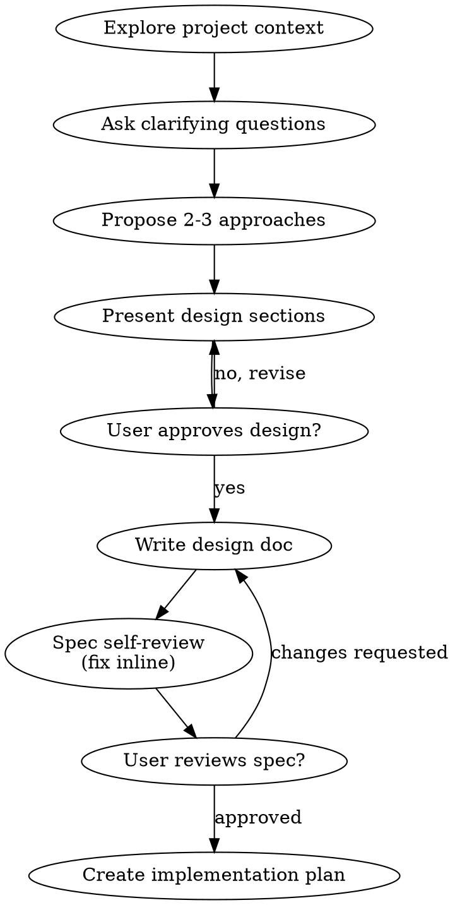

# Brainstorming Ideas Into Designs

Turn ideas into fully formed designs + specs through natural collaborative dialogue.

Understand project context first, then one question at a time; once understood, present design, get approval.

<HARD-GATE>
No implementation skill, no code, no scaffolding, no implementation action until design presented + user approved. EVERY project, regardless of perceived simplicity.
</HARD-GATE>

## Anti-pattern: "too simple to need a design"

Skill triggers only on genuinely unclear intent — but within that scope, never shortcut the design gate because work looks simple. Todo list, single-function utility, config change with open questions: "simple" projects = where unexamined assumptions waste the most work. Design can be short (few sentences for truly simple projects), but present + get approval before implementing.

## Checklist

Create task per item, complete in order:

1. Explore project context — files, docs, recent commits
2. Offer visual companion just-in-time — NOT upfront. First time a question is genuinely clearer shown than described, offer then (own message); on approval its browser tab opens. No visual question ever arises → never offer. See Visual Companion section.
3. Ask clarifying questions — one at a time; purpose/constraints/success criteria
4. Propose 2-3 approaches — trade-offs + recommendation
5. Present design — sections scaled to complexity, user approval after each
6. Write design doc — `docs/specs/YYYY-MM-DD-<topic>-design.md`, commit
7. Spec self-review — inline check: placeholders, contradictions, ambiguity, scope (below)
8. User reviews written spec — before proceeding
9. Transition to implementation — create implementation plan

## Process flow

Terminal state = approved design + written spec. No frontend-design or any implementation skill; next step = implementation plan, not code.

## The process

### Understanding the idea

- Check current project state first (files, docs, recent commits)
- Before detailed questions, assess scope: request describes multiple independent subsystems (e.g. "platform with chat, file storage, billing, analytics") → flag immediately. Don't burn questions refining details of a project needing decomposition.
- Project too large for single spec → help decompose into sub-projects: independent pieces, relationships, build order. Then brainstorm first sub-project through normal flow. Each sub-project gets own spec → plan → implementation cycle.
- Appropriately scoped → one question at a time; prefer multiple choice, open-ended fine too; one question per message (topic needs more → split into multiple questions); focus on purpose, constraints, success criteria

### Exploring approaches

- 2-3 approaches with trade-offs
- Conversational, with recommendation + reasoning
- Lead with recommended option, explain why
- YAGNI ruthlessly — remove unnecessary features from every approach + design

### Presenting the design

- Understood → present design
- Scale sections to complexity: few sentences if straightforward, 200-300 words if nuanced
- After each section: "does this look right so far?"
- Cover: architecture, components, data flow, error handling, testing
- Ready to go back + clarify when something doesn't make sense

### Design for isolation + clarity

- Break system into smaller units: one clear purpose each, well-defined interfaces, independently understandable + testable
- Per unit answerable: what does it do, how do you use it, what does it depend on?
- Unit understandable without reading internals? Internals changeable without breaking consumers? No → boundaries need work.
- Smaller well-bounded units also easier for YOU: better reasoning over code held in context, more reliable edits with focused files. File growing large = doing too much.

### Existing codebases

- Explore current structure before proposing changes. Follow existing patterns.
- Existing problems affecting the work (oversized file, unclear boundaries, tangled responsibilities) → targeted improvements included in design, like a good developer would.
- No unrelated refactoring. Stay on what serves current goal.

## After the design

### Documentation

- Validated design (spec) → `docs/specs/YYYY-MM-DD-<topic>-design.md` (user preferences for spec location override default)
- Commit design doc to git

### Spec self-review

Fresh eyes after writing:

1. Placeholder scan: "TBD", "TODO", incomplete sections, vague requirements → fix.
2. Internal consistency: sections contradicting? Architecture matching feature descriptions?
3. Scope check: focused enough for single implementation plan, or needs decomposition?
4. Ambiguity check: requirement interpretable two ways → pick one, make explicit.

Fix inline. No re-review — fix, move on.

### User review gate

Spec review passes → ask user:

> "Spec written and committed to `<path>`. Please review it and let me know if you want to make any changes before we start writing out the implementation plan."

Wait. Changes requested → make them, re-run spec review loop. Proceed only on approval.

### Implementation

- Detailed implementation plan from spec
- No implementing before plan exists.

## Visual Companion

Browser-based companion for mockups, diagrams, visual options during brainstorming. A tool — not a mode. Accepting = available for visual-benefit questions; NOT every question through browser.

### Offering (just-in-time)

Never upfront. Wait until a question is genuinely clearer shown than told — real mockup/layout/diagram question, not merely a UI *topic*. First time that happens, offer then, own message:
> "This next part might be easier if I show you — I can put together mockups, diagrams, and comparisons in a browser tab as we go. It's still new and can be token-intensive. Want me to? I'll open it for you."

**Offer MUST be its own message.** Only the offer — no question, summary, other content. Wait. Accept → start server with `--open` (browser opens to first screen). Decline → text-only, never offer again unless user raises it.

### Per-question decision

Even after acceptance, decide per question: browser or terminal. Test: **would user understand better by seeing than reading?**

- Browser for visual content — mockups, wireframes, layout comparisons, architecture diagrams, side-by-side designs
- Terminal for text content — requirements, conceptual choices, tradeoff lists, A/B/C/D options, scope decisions

UI topic ≠ automatically visual question. "What does personality mean here?" = conceptual → terminal. "Which wizard layout works better?" = visual → browser.

Companion accepted → read `skills/brainstorming/references/visual-companion.md` before proceeding.
