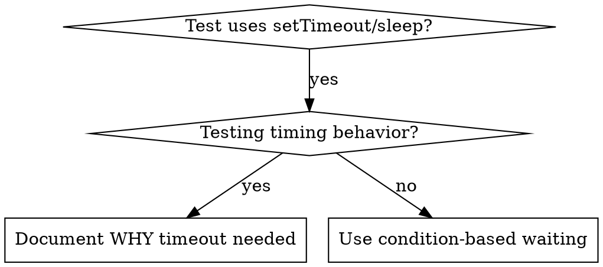

# Condition-Based Waiting

## Overview

Flaky tests guess timing with arbitrary delays → race conditions: pass on fast machines, fail under load/CI.

Core: wait for the actual condition, not a guess about duration.

## When to Use



Use when:
- Arbitrary delays in tests (`setTimeout`, `sleep`, `time.sleep()`)
- Flaky tests (pass sometimes, fail under load)
- Timeouts when run in parallel
- Waiting on async operations

Not when testing actual timing behavior (debounce, throttle intervals) — if arbitrary timeout used there, always document WHY.

## Core Pattern

```typescript
// ✗ BEFORE: guessing at timing
await new Promise(r => setTimeout(r, 50));
const result = getResult();
expect(result).toBeDefined();

// ✓ AFTER: waiting for condition
await waitFor(() => getResult() !== undefined);
const result = getResult();
expect(result).toBeDefined();
```

## Quick Patterns

| Scenario | Pattern |
|----------|---------|
| Wait for event | `waitFor(() => events.find(e => e.type === 'DONE'))` |
| Wait for state | `waitFor(() => machine.state === 'ready')` |
| Wait for count | `waitFor(() => items.length >= 5)` |
| Wait for file | `waitFor(() => fs.existsSync(path))` |
| Complex condition | `waitFor(() => obj.ready && obj.value > 10)` |

## Implementation

Generic polling:
```typescript
async function waitFor<T>(
  condition: () => T | undefined | null | false,
  description: string,
  timeoutMs = 5000
): Promise<T> {
  const startTime = Date.now();

  while (true) {
    const result = condition();
    if (result) return result;

    if (Date.now() - startTime > timeoutMs) {
      throw new Error(`Timeout waiting for ${description} after ${timeoutMs}ms`);
    }

    await new Promise(r => setTimeout(r, 10)); // Poll every 10ms
  }
}
```

Full implementation + domain helpers (`waitForEvent`, `waitForEventCount`, `waitForEventMatch`) from real session: `condition-based-waiting-example.ts` in this directory.

## Common Mistakes

✗ Polling too fast: `setTimeout(check, 1)` — wastes CPU. ✓ Poll every 10ms
✗ No timeout: loops forever if condition never met. ✓ Always timeout + clear error
✗ Stale data: state cached before loop. ✓ Call getter inside loop for fresh data

## When Arbitrary Timeout IS Correct

```typescript
// Tool ticks every 100ms - need 2 ticks to verify partial output
await waitForEvent(manager, 'TOOL_STARTED'); // First: wait for condition
await new Promise(r => setTimeout(r, 200));   // Then: wait for timed behavior
// 200ms = 2 ticks at 100ms intervals - documented and justified
```

Requirements: first wait for triggering condition; based on known timing (not guessing); comment explaining WHY.

## Real-World Impact

Session 2025-10-03: 15 flaky tests fixed across 3 files, pass rate 60% → 100%, execution 40% faster, no race conditions.
