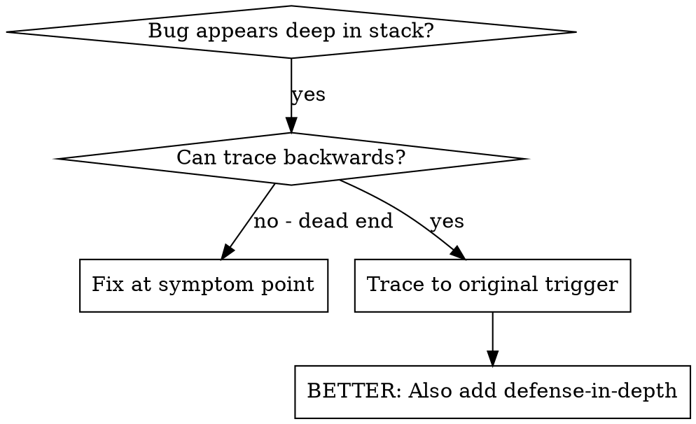
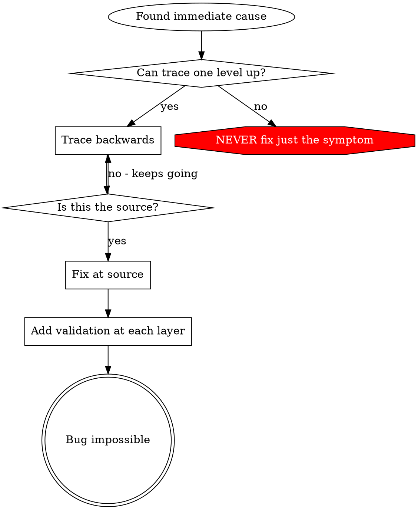

# Root Cause Tracing

## Overview

Bugs manifest deep in call stack (git init in wrong dir, file in wrong location, DB opened with wrong path). Instinct = fix where error appears = symptom.

Core: trace backward through call chain to original trigger, fix at source.

## When to Use



- Error deep in execution (not entry point)
- Long stack trace call chain
- Unclear where invalid data originated
- Need to find which test/code triggers problem

## The Tracing Process

### 1. Observe symptom

```
Error: git init failed in ~/project/packages/core
```

### 2. Find immediate cause

```typescript
await execFileAsync('git', ['init'], { cwd: projectDir });
```

### 3. What called this?

```typescript
WorktreeManager.createSessionWorktree(projectDir, sessionId)
  → called by Session.initializeWorkspace()
  → called by Session.create()
  → called by test at Project.create()
```

### 4. Keep tracing up

Value passed?
- `projectDir = ''` (empty!)
- Empty string as `cwd` resolves to `process.cwd()`
- = source code directory

### 5. Original trigger

Where'd empty string come from?
```typescript
const context = setupCoreTest(); // Returns { tempDir: '' }
Project.create('name', context.tempDir); // Accessed before beforeEach!
```

## Adding Stack Traces

Can't trace manually → instrument:

```typescript
// Before the problematic operation
async function gitInit(directory: string) {
  const stack = new Error().stack;
  console.error('DEBUG git init:', {
    directory,
    cwd: process.cwd(),
    nodeEnv: process.env.NODE_ENV,
    stack,
  });

  await execFileAsync('git', ['init'], { cwd: directory });
}
```

Critical: `console.error()` in tests (logger may not show)

Capture:
```bash
npm test 2>&1 | rg 'DEBUG git init'
```

Analyze stacks: test file names, triggering line number, pattern (same test? same parameter?).

## Finding Which Test Causes Pollution

Appears during tests, unknown which test → bisection script `scripts/find-polluter.sh` (relative to skill dir):

```bash
scripts/find-polluter.sh '.git' 'src/**/*.test.ts'
```

Runs tests one-by-one, stops at first polluter. See script for usage.

## Real Example: Empty projectDir

Symptom: `.git` created in `packages/core/` (source code)

Trace chain:
1. `git init` runs in `process.cwd()` ← empty cwd param
2. WorktreeManager called with empty projectDir
3. Session.create() passed empty string
4. Test accessed `context.tempDir` before beforeEach
5. setupCoreTest() returns `{ tempDir: '' }` initially

Root cause: top-level variable init accessing empty value
Fix: tempDir made a getter that throws if accessed before beforeEach

Defense-in-depth added:
- Layer 1: Project.create() validates directory
- Layer 2: WorkspaceManager validates not empty
- Layer 3: NODE_ENV guard refuses git init outside tmpdir
- Layer 4: stack trace logging before git init

## Key Principle



**NEVER fix just where error appears.** Trace back to original trigger.

## Stack Trace Tips

Tests: `console.error()` not logger — logger may be suppressed
Before operation: log before the dangerous op, not after it fails
Context: directory, cwd, env vars, timestamps
Stack: `new Error().stack` = complete call chain

## Real-World Impact

Session 2025-10-03: root cause via 5-level trace, fixed at source (getter validation), 4 defense layers, 1847 tests passed, zero pollution.
